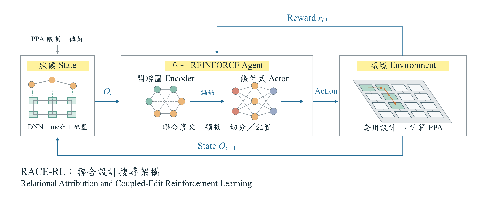

# RACE-RL

使用單一 RL Agent 聯合搜尋 chiplet 數量、DNN 切分、工作配置及資料配置的研究框架。研究主流程採 float64；實體硬體為 **compute-only mesh**，外部記憶體以服務介面建模，沒有實體 memory chiplet。



[完整 RL 架構定義](docs/research/rl_architecture.md)｜[中文研究進度](docs/research/research_progress.md)｜[核心假說驗證](docs/research/hypothesis_results.md)

## 搜尋設定

- 運算 chiplet：預設 2／4／6／8／10／12／14／16；16 顆為 4×4 mesh。
- 一個 policy、graph encoder、critic 與 optimizer；每一步可交錯改顆數、整層 retile 或 coupled mapping。
- 外部記憶體介面連到 c0／cN-1；不占 mesh 格點、不作路由轉送，容量／頻寬／能量仍納入評估。
- 以固定初始 EDP 正規化，所有硬體共用 oracle budget；失敗候選與 initial 計入，快取算 request。
- 較差但可行的 current state 可接受；一次差的 mapping 不排除整個顆數，另存 global best。

## 執行

Python 3.12 建議：

```sh
python3 -m venv .venv
.venv/bin/python -m pip install -e '.[rl,cnn,reports]'
.venv/bin/python tools/verify_sources.py
.venv/bin/python -m unittest discover -s tests -v
.venv/bin/python -m race_rl.cli search-mesh --model resnet18 --episodes 3 --budget 16 --out experiments/runs/new_search
.venv/bin/python tools/run_hypothesis_pilot.py --out experiments/runs/new_hypotheses
```

新輸出目錄須為空。小型當前證據在 `docs/research/evidence/`；完整 raw ledger／checkpoint 在忽略的 `experiments/runs/`。研究程式在 `src/race_rl/`，主驗證在 `tests/`；`third_party/rapidchiplet-main/` 為現行必要依賴。

## 目前驗證

96 項測試通過；七個完整 CNN 在 224×224、float64 下通過數值與外部記憶體容量檢查。已執行完整 ResNet-18／16 顆 mesh PPO pilot，以及 10 variants×3 paired seeds 的 H1/H2/H3 開發實驗（480 次訓練、240 次凍結搜尋評估）。

這些是可重現的開發證據。硬體係數未校準；沒有 silicon PPA、全域最优、正式統計顯著性或跨 CNN 泛化主張。本次沒有提交或推送 GitHub，CI 尚未在 GitHub 執行。授權與第三方說明見 [THIRD_PARTY_NOTICES.md](THIRD_PARTY_NOTICES.md)。
