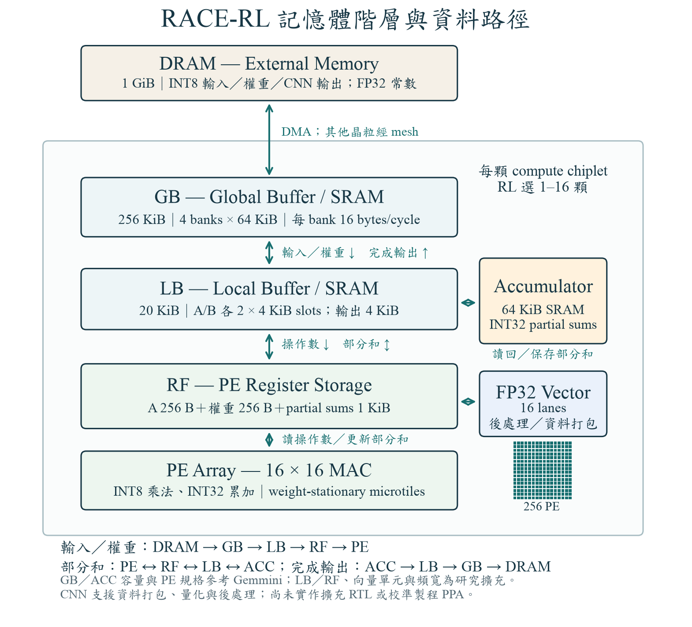

# 完整 CNN 記憶體階層、單一 RL 與實驗入口

2026 年 10 月 14 日建立 `race_gemmini_cnn_hierarchy_v1`。目前七種 Torchvision CNN 已能經過明確的量化流程，送入新記憶體階層的分析式環境；GUI 預設也已切換。這代表軟體／數值／資料流串接完成，**不代表新增硬體已有 RTL、PPA 已量測，或 RL 的改善已得到實驗證明**。

## 硬體與資料路徑



每顆 chiplet 固定使用 256 個 PE（16×16）、GB 256 KiB、LB 20 KiB、RF 1536 bytes、SRAM accumulator 64 KiB，另加入研究用 16-lane FP32 向量單元。由同一個 Agent 選 1–16 顆，矩形 mesh 與 XY routing 固定。晶粒座標是 mesh 格點，不是製程尺寸。

| 元件 | CNN 模型分工 | 身份 |
| --- | --- | --- |
| 外部 DRAM | INT8 輸入、packed 權重、非駐留 activation、FP32 常數、最終輸出 | 1 GiB／16 bytes per cycle／每 transaction 20 cycles 為研究情境 |
| GB bank 0 | 64 KiB activation cache；依真正 consumer／alias 生命週期釋放 | 固定公開容量的研究分配 |
| GB bank 1 | 64-byte gather staging、packed A、INT32／FP32 輸出暫存 | 不另設晶粒內 DRAM |
| GB bank 2／3 | B 權重；每顆只保留一個 N-block，換 block 就失效 | 沒有無限權重 cache |
| LB | A／B panels、RF／ACC 之間的部分和，以及輸出 microtile 串流 | 逐層讀写計帳；容量不足拒絕所選 action |
| RF | PE／向量單元的操作數與 microtile 部分和 | 與 SRAM accumulator 分開 |
| Accumulator | K16 reduction 之間的 INT32 部分和 | RF↔LB↔ACC；完成後 ACC→LB→GB |
| FP32 vector | streamed-im2col 打包、bias、BN、Add、activation、pooling、requantization | 本專案新增硬體假設；目前沒有 RTL |

GB／ACC 容量與 PE 參數參照固定 [Gemmini 官方來源](gemmini_hardware.md)。[官方 Gemmini 架構](https://github.com/ucb-bar/gemmini#architecture)採 scratchpad 與獨立 accumulator；它沒有直接實作本專案新增的 LB／向量單元。`configs/cnn_hardware.json` 保存完整硬體身份與界線，不把本配置稱為官方 defaultConfig 的逐週期執行器。

## 模型切分與資料生命週期

四組固定軟體 profiles 為 `(H,W,Cout,K)`：`(8,8,16,16)`、`(8,16,32,32)`、`(16,8,32,32)`、`(16,16,64,64)`。它們不改變硬體陣列大小或 SRAM 容量。

- H／W 切分輸出空間；輸出通道 Cout 切分輸出 ownership。每個元素恰好屬於一個 tile，尾端直接取有效範圍。
- 卷積的 GEMM 對應為 M=輸出位置、N=群組中的輸出通道、K=群組的輸入通道×kernel H×kernel W。K blocking 是晶粒內的 reduction，**目前不含跨 chiplet 的 K reduction**。
- Grouped／depthwise／dilated convolution 明列群組、kernel 與 halo。有效輸入參照依座標計算；padding 由打包器產生零，stride 造成的實際 row-span 空隙仍計傳輸。
- Source region 從真正的 producer ownership 查詢。DRAM 與同晶粒 GB／跨晶粒 GB 分開：GB peer activation 經 mesh，沒有再免費回到 DRAM。
- 權重可在 GB 跨 M groups 駐留；RF 權重跨 M16 microtiles 複用，A 在 LB 跨 N16 使用。GB 的一個 N-block cache 有明確替換規則。
- Flatten／eval Identity 為 alias，不複製資料、不使用算子 edit slot；alias consumer 會延長原始 tensor 的存活時間。
- 持續保留的 activation 加上本層輸出必須放入各顆 GB 的 64 KiB cache。容量不足是 physical failure，不替 Agent 偷偷 spill 或改小 tile。
- 層與層之間有 barrier。最終輸出即使原先選 GB 駐留，仍計 host export 的 DMA／mesh 成本。

目前沒有跨層融合、任意硬體尺寸 DSE、任意逐 tile mapping、跨晶粒 K reduction 或 packet／credit 模擬。位置家族為指定起點的 single／round-robin。範圍有限但明確，不能稱為全部可能架構的完整枚舉。

## 精度與數值驗證

Source CNN 是 seeded random weights、CPU FP32，不下載 pretrained weights。以同一個固定種子輸入作每個 tensor／weight 的 symmetric per-tensor INT8 calibration；範圍 `[-127,127]`、FP32 reciprocal、nearest-even、saturation。Conv／Linear 採 INT32 整數累加，bias／BN／pooling／Add／activation／requantize 採明定的 FP32 路徑。

量化由 `cnn_quantization.py` 實作；沒有把浮點圖描述的 bytes 直接當成 INT8。INT32 overflow／非整數結果會拒絕；小型 H／W／C gather＋K16 GEMM 的數值結果，另對照 grouped／dilated 直接 INT64 convolution 與完整整數卷積參照。

每模型報告保存 source 與量化參數的 SHA、輸出 SHA、對 FP32 source 的最大誤差／RMSE、飽和值數量。這些是執行、形狀與數值核對。單個校準輸入與隨機權重**沒有證明 ImageNet 準確率、校準代表性或量化可接受性**。未保存大型 weight arrays；正式準確率研究還需要真實模型與校準／驗證資料集。

## 一個完整 action 與標準 RL 流程


一次 action 是完整 `CNNDesign`，包含 chiplet 顆數與每個算子的 H／W／Cout／K、位置、分散方式、activation／weight 駐留。它由 current design 加最多 2 個相依實作算子的不同 edits 組成，其他算子保留；縮小 mesh 時，移除的 target 依 modulo 重映射，整套配置仍完整。

一個共享關聯圖 Encoder、一個 joint Actor、一個 Adam optimizer。Actor 在一次 Encoder forward 後依序抽樣顆數、anchor，以及 scope 中每個算子的 profile、residency、layout、target；scope=2 一般是 10 個離散選擇。這些是組成 **一個** action 的決策，不是 10 次環境互動。其間沒有環境評估、PPA lookahead、另一個 mapper、Critic 或 PPO。所有 count 1–16 都保留，只有 target 的存在性與 alias 等結構語義限制。

完整 action → 一次環境入口 → PPA／reward／新 state → 下一個 action。有效但較差／超標的設計可成為 current，best archive 另存；物理失敗回饋原因與 reward=0。缺成本時 reward=None，不能偷偷用 cycles／bytes 當成 PPA reward。相同所選完整設計可重用當回合快取，仍計一次互動。

回合最多 64 次完整互動，結束後一次 REINFORCE 更新：gamma=1、learning rate=3e-4、gradient norm clip=0.5、無 critic，RL parameters／features／returns 使用 float64。GUI 不顯示每 action 的「評估上限」；action 一完成就評估。60 回合只是預設預算，不是收斂保證。

Schema 8：算子節點 42 維，包括形狀、groups、stride／padding／dilation、當前完整 profile／位置／駐留及觀察到的時間；hardware 9 維、link 4 維、global 22 維、PPA task 16 維。GB／LB／RF／ACC、PE、vector、DMA、DRAM 都有節點，並回饋實際模型得到的 D2D bytes 與 dependency-link 歸因。未知 busy／criticality 不假裝已被量測。GB／LB／RF／ACC 的總存取與 cache peak 也回到 state。

## 時間與 PPA 的可信度界線

為避免為每個 MAC 建事件，重複 WS microprogram 使用封閉式計數；已與詳細 Gemmini 模型的小型案例核對 GB／LB／RF／ACC 存取。CNN timing 是各層 `max(node service, shared DRAM service, directed-link service)` 的瓶頸估計，再依序加上 layer barriers 與 host export。K panel-copy 指令另採每組 2-cycle 的研究 dispatch 假設。

這個瓶頸公式不是逐週期 scheduler、可行排程證明或延遲上界。晶粒內的完整 pipeline 與網路 queue 尚未校準。搜尋程序的 CPU wall time 是「評估器／Actor 執行多久」，不能當成 chiplet 推論時間。

PPA 成本檔使用 `configs/cnn_ppa_template.json`：純 MAC、GB／LB／RF／ACC endpoint reads+writes、DRAM payload、DMA bus bytes、mesh byte-hops、向量運算、static power、clock，以及含 vector／DMA／router／PHY 的完整 compute die area。MAC 不重複包含 RF；copy 的來源讀、目的寫各計一次。每條 D2D hop bytes 計一次，dependency-link annotation 可對應多個 consumers，不用 annotation 重複加能量。

成本必須逐項附來源／明確估計，綁定 `cnn_hardware_identity`。舊合成係數、GEMM-only 成本、舊可行性 witness、舊 checkpoint 均不能直接套用。`DECLARED_ESTIMATE / RTL_DERIVED / MEASURED` 是提供者的宣告，欄位填完不等於程式已獨立驗證量測。即使係數有來源，本模型 timing 仍未校準，報告 `physically_calibrated=false`。

### 可直接載入的估計成本情境

`configs/ppa_profiles/` 提供三份完整 JSON，可直接載入 GUI 或傳入 CLI 的 `--ppa-profile`。建議先使用基準檔。三份皆為 `DECLARED_ESTIMATE`，可訓練估計情境下的策略；沒有取得這套擴充硬體的 RTL 或矽片成本。完整逐項來源、轉換公式、硬體身份與限制保存在 [provenance.json](../../configs/ppa_profiles/provenance.json)。該檔是說明資料，不是 GUI 成本檔。

| 成本檔 | 用途 | 相對基準改變 |
| --- | --- | --- |
| [cnn_45nm_reference.json](../../configs/ppa_profiles/cnn_45nm_reference.json) | 基準研究情境 | 無 |
| [cnn_45nm_memory_2x.json](../../configs/ppa_profiles/cnn_45nm_memory_2x.json) | 記憶體能耗敏感度 | GB／LB／RF／ACC／DRAM 動態能耗 ×2 |
| [cnn_45nm_mesh_2x.json](../../configs/ppa_profiles/cnn_45nm_mesh_2x.json) | 跨晶粒傳輸能耗敏感度 | mesh 每 byte-hop 動態能耗 ×2 |

固定時脈 **500 MHz**、單顆運算晶粒估計面積 **5.0 mm²**；容量、每週期頻寬、靜態功耗、向量成本與 RL 條件相同。若面積上限為 16 mm²，這些情境最多只有 3 顆可能符合面積限制；16 顆合計 80 mm²。RL 仍可探索 1–16 顆，不會因載入成本檔而縮減動作集合，使用者限制也不會被改寫。

運算／記憶體參考 [Horowitz, ISSCC 2014](https://doi.org/10.1109/ISSCC.2014.6757323) 的粗略 45nm 能耗，依 64-bit 存取轉成每 byte；MAC 純算術為 INT8 乘法加 INT32 加法。GB 64KiB bank 採對數容量內插、LB 用較大的 8KiB bank 代替、ACC 用 32KiB bank，讀寫等價與每 byte 線性分攤均是假設，不是 SRAM macro 模擬。

面積以 [Gemmini DAC 2021 Fig.6](https://people.eecs.berkeley.edu/~ysshao/assets/papers/genc2021-dac.pdf) 的 22nm 分解扣除 host CPU，採粗略平方製程縮放，再加 LB、RF、向量單元與 router／自訂 PHY 的宣告預留。互連以 [IEEE EDPS 2023 UCIe 簡報第 20 頁](https://www.ieee-edps.com/archives/2023/c/0900sharma.pdf) 的 PHY 能耗目標加 router 預留作代理值。本專案沒有實作 UCIe；這些混合來源不能視為完整 45nm 製程配置。

RF、DMA、混合向量操作、擴充邏輯面積和靜態功耗仍含明確研究假設。DRAM 動態 I/O 包含在 external 成本內，DMA 只加控制／位址成本，GB／LB／RF／ACC 端點另各計一次。兩個 ×2 情境是單類成本擾動，不是信賴區間。報告可描述為「公開參考與明列假設的分析式成本情境」，不可描述為目前硬體的實測 PPA。配對比較需固定輸入、seed、互動預算及同一使用者 PPA 限制。

## 終端機執行與保存

macOS 使用 `.venv/bin/python`；Windows 使用 `.venv\Scripts\python.exe`。七模型依序啟動各自 subprocess，釋放 source CNN 與量化 arrays 後再搜尋。每個模型獨立訓練同規格的單一 Agent，不宣稱跨模型泛化。

先檢視七模型各一次完整動作，不訓練：

```sh
python tools/train_model_suite.py --inspect --models all --input-size 64 --out experiments/runs/cnn_hierarchy_inspect
```

短程測試只驗證串接，係數是 `TEST_FIXTURE`：

```sh
python tools/train_model_suite.py --integration-smoke --models all --input-size 64 --evaluation-seeds 17 --out experiments/runs/cnn_hierarchy_smoke
```

正式估計模式需要已填好且有來源的成本檔與廠商限制；空白 template 會被拒絕：

```sh
python tools/train_model_suite.py --train --models all --input-size 64 --episodes 60 --ppa-profile path/to/sourced_cnn_costs.json --requirements path/to/vendor_limits.json --out experiments/runs/cnn_hierarchy_training
```

每模型 60 回合、每回合 64 次互動；另做相同預算的訓練前／後凍結策略測試，預設 seeds 17／29／43、不更新參數。這些測試互動是額外成本，與 training 分開記錄；前後測等預算不等於已做 random／SA 的全訓練預算比較。可選 `--early-stop` 啟用至少 20 回合、patience 15、0.1% 門檻。

TTY 只刷新同一行，顯示模型、階段、互動數、耗時、ETA；非 TTY 只輸出階段摘要。ETA 以已完成速度粗估，不能當最長時間保證。Ctrl+C 保留最後完整提交的回合；用 **凍結原 protocol** 續跑：

```sh
python tools/train_model_suite.py --out experiments/runs/cnn_hierarchy_training --resume
```

每模型只留壓縮 `history.sqlite`、單一 transactional checkpoint、數值／量化 manifest、回合統計與一套 selected-design feedback；不保存每 MAC 或每候選的完整事件圖。根目錄 `report.html`／`batch_summary.json` 彙整結果與時間。SQLite 在成功、失敗、中斷及續跑後均明確關閉。

原入口仍可作歷史比較：`tools/train_model_suite.py --legacy-synthetic ...` 或 `race-rl search-mesh ...`。新 CLI 也可用 `race-rl search-cnn ...`。舊結果不能改名成新版成果。

## GUI 與最後的校準工作

GUI 預設新版 CNN。可載入小於 50 KB 的成本 JSON；未載入時只顯示一次完整動作的 cycles、mesh、配置與各層存取，策略更新 0 次、PPA 留空。載入且通過來源／硬體身份檢查後才執行 PPA 訓練。進階選項保留舊合成比較；GUI 不接受 `TEST_FIXTURE`。新啟動 protocol=2，避開仍在跑的舊 server，不終止其他程序。

`tools/export_cnn_calibration.py` 已提供 6 個固定小型 GEMM／tail／grouped／depthwise／vector 數值與校準參照、NPZ hashes 及完整硬體 manifest。它沒有執行 RTL 或量測，也不啟用正式 PPA：

```sh
python tools/export_cnn_calibration.py --out experiments/runs/cnn_calibration_cases
```

要完成實體可信度，仍須實作／取得本 LB、INT32 microprogram 與 FP32 vector 的匹配 RTL，取得逐 case cycles／port trace，並取得固定製程、電壓、時脈的 SRAM／RF／MAC／vector／DMA／D2D 能量與完整晶粒面積。僅跑未修改的 Gemmini RTL 或使用 CPU wall time，不能完成這套擴充架構的校準。[Gemmini 官方](https://github.com/ucb-bar/gemmini#building-gemmini-hardware-and-cycle-accurate-simulators)也區分 functional 與 cycle-accurate simulation。

## 本次驗證紀錄

216 個本機回歸測試通過；七模型各跑 2 回合／8 次訓練互動，另有前後各 4 次凍結互動，共 16 次／模型。全部有 2 次策略更新，凍結階段的參數 hash 保持一致。成本為 TEST_FIXTURE；這是串接與保存驗證，不是學習優勢或收斂實驗。

本次七模型總 CPU wall time 約 104.9 秒，包含匯入、量化與小型實驗，不能直接乘成正式 60 回合時間或當成晶粒延遲。各模型時間、數值誤差、回合統計與來源在 [精簡摘要](evidence/cnn_hierarchy/model_summaries.json)；[HTML 報告](evidence/cnn_hierarchy/report.html) 與 [平台／完整驗證界線](evidence/cnn_hierarchy/verification.json) 可供查核。

另經真正網頁操作驗證 ResNet18／224×224、一次完整動作、8 顆 mesh、模型資料流與成本缺值提示。網頁更新沒有訓練策略或產生假 PPA；圖見 [網頁截圖](figures/cnn_gui.jpg) 與 [完整 SVG](figures/cnn_gui_design.svg)。
