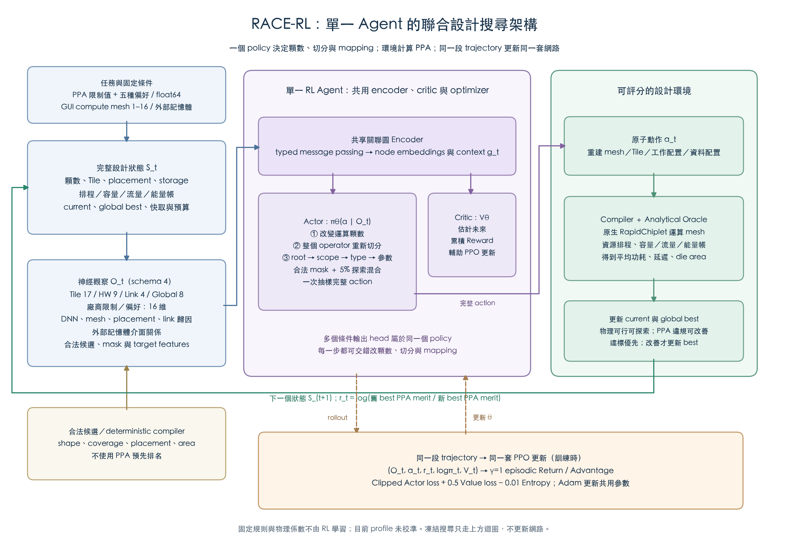

# 單一 RL Agent 的架構定義

本文件定義目前已實作的系統。主流程是 **一個圖編碼器、一個條件式 Actor、一個 Critic、一個 PPO optimizer**。每一步由同一個 policy 決定顆數、模型切分、工作配置或資料配置；沒有額外的顆數 optimizer，也沒有 Greedy 先挑好動作交給 RL。

可編輯向量圖：[SVG](figures/rl_architecture.svg)。圖由 `tools/draw_rl_architecture.py` 依目前模組產生。

## 1. 問題與目標

一個 task 固定 DNN operator graph、數值精度、單顆 compute 的能力與容量、mesh 產生規則及外部記憶體服務 profile。GUI 的運算 chiplet 候選固定為 1–16 任一整數，系統起始 2 顆，不提供廠商顆數旋鈕；當前配對研究 pilot 固定使用子集合 `{2,4,6,8,10,12,14,16}`，沒有實體 memory chiplet；16 顆形成 4×4 compute mesh。

外部記憶體介面 `dram0`／`dram1` 分別連到 `c0`／`cN-1`，供 storage 及資料讀寫評估。它們不是 die、不占 mesh 格點、不作路由轉送；容量、有效讀寫頻寬、動態能量及 static power 仍會計入。`memory_port_edge_index` 表示邏輯介面關係，與實體 mesh links 分開。

廠商先輸入平均功耗、推論延遲、運算 die area 上限，再選五種偏好之一。目標是先達標，再最小化依權重及限制值正規化的 PPA 算術加權成本。搜尋 merit 將達標設計排在任何違規設計之前；同回合 reference 固定。完整公式、權重及入口見 [廠商需求](vendor_requirements.md)。所有物理係數目前是明示的未校準假設。

## 2. 完整環境狀態 S_t 與神經觀察 O_t

**S_t** 是環境持有的設計與搜尋狀態：

- 固定 workload／參數形狀與物理係數。
- 目前顆數、compute mesh、外部記憶體介面與容量。
- 每個 operator 的 Tile regions、Tile-to-compute placement、tensor／parameter storage。
- oracle 的排程、criticality、flow／link 歸因、buffer lifetime／peak、能量帳及可行性。
- 目前設計與已驗證 global best 的硬體／mapping／PPA 分數及是否達標。
- 以 hardware+mapping 為身份的評估快取、evaluation／request counters、剩餘預算。

**O_t** 是從 S_t 投影出的 `DesignObservation`，其中 `GraphObservation` 為 schema 4：

| 資料 | 目前提供給網路的特徵／關係 |
| --- | --- |
| Tile features：17 維 | 11 種 operator one-hot；log operations／input bytes／output bytes；compute service/makespan；slack/makespan；critical flag |
| Hardware/service features：9 維 | compute／memory／IO role；log compute throughput／capacity／bandwidth；x／y；resource utilization |
| Directed physical-link features：4 維 | log bandwidth、log attributed bytes、busy fraction、critical flag |
| Global features：8 維 | log current／best normalized PPA merit、remaining／used evaluation fractions、目前平均功耗／latency、normalized compute count、remaining request fraction |
| Vendor task features：16 維 | 權重 3、限制旗標 3、固定尺度 log 3、current/scale log 3、current/limit log 3、best 達標旗標 1 |
| Graph relations | DNN dependency、physical mesh links、Tile placement、dependency-to-link attribution、外部 memory-to-gateway 介面關係 |
| 候選資料 | 合法 action、mask、count target features、retile／independent-edit target features |

完整 cache identities 與 best hardware hash 保留為 metadata，但 encoder 沒有逐筆讀取整個 cache，也沒有 RNN/history encoder。Tile regions 在完整設計中存在，神經 Tile feature 尚未逐維輸入完整 NCHW bounds。因此目前不能宣稱這個壓縮觀察已被證明具完整 Markov state sufficiency。

## 3. 共享圖 Encoder

`RelationalEncoder` 先用 Linear+Tanh 編碼 Tile 與 hardware/service nodes，再對不同關係使用可學習的線性訊息：DNN、mesh、memory-interface、placement、dependency-link attribution。將訊息加到原 embedding 後經 Tanh。

Actor 選 action 時不呼叫 PPA oracle；candidate logits 是機率參數，Critic 是累積 reward 的估計。完整逐步流程見 [詳細訓練流程](training_process.md)。

Tile／hardware embeddings 的 mean pooling 與 8 維 global features、16 維廠商 task features 拼接，再經 MLP 得到 context `g_t`。預設 width=32；核心假說 Toy pilot 固定 width=16。

目前是一次 typed message aggregation，沒有宣稱已實作多層 GAT、Transformer、learned graph expansion 或 recurrent memory。State ablations 會停用指定訊息路徑，且維持相同網路參數量。

## 4. Actor：同一個 policy 決定完整 action

Actor 先選當下合法 action family，再對該 family 的參數評分：

| Family | Agent 決定 | 條件式解碼 |
| --- | --- | --- |
| Mesh resize | 目標運算 chiplet 數量 | context + target count/layout features |
| Whole-operator retile | operator、parts、compute target、集中／分散 | context + operator Tile-group embedding + target hardware embedding + parts/spread |
| Coupled mapping | root、connected scope、transaction kind、targets／count | `root → scope → type → parameters` 的條件 log probability |

Coupled transactions 包含 `cut_migrate`、`work_share` 與 `memory_affinity`。同一個 policy 可在任何一步交錯三個 family；不採先選架構後永久鎖定 mapping 的兩階段流程。

合法 root／connected scopes 由 deterministic generator 列出，最大 scope 可設 1～4，RL 選擇其中的目標與範圍。實際選擇是將條件分布展開成 joint categorical，**一次抽樣完整 action**；目前不是由 RL 逐節點擴張子圖。

Action-family 與合法條件參數分布各混入 5% uniform exploration，masked action 機率為零。PPO 儲存及重算的 log probability 是實際 mixture 的機率，保持採樣與更新一致。多個輸出 head 屬於同一個 Actor，不是多個獨立 agent。

H2 的 independent control 仍使用同一 agent，改成每步只選一個 Tile placement、一個 storage object 或一個 operator partition count。partition-only 沿舊 Tile 最大輸出交集繼承 placement，後續配置由 agent 再改。

## 5. 環境 transition 與實際評分

`DesignEnvironment.step(a_t)`：

1. 套用 atomic action。Resize 保留仍存在的 compute ID，將刪除 ID 的 Tile 按原 ID modulo 新數量重定位；不使用 PPA 挑目的地。Retile 重建整個 operator，保留其他 operator。
2. 重新驗證 shape／coverage／placement／storage，重編譯依賴、halo、讀寫、路由、資源排程與 lifetime。
3. `DesignOracle` 以 hardware+mapping 查快取，否則作完整 oracle evaluation。
4. 原生 RapidChiplet 只評估實體 compute mesh 的幾何／鏈路／native delay／die area／idle power；本專案另算 memory service、compute service、E2E schedule、容量與 energy ledger。
5. 物理可行候選更新 current，即使加權成本較差或暫時 PPA 超標；best 只接受已評估且 feasibility-first merit 改善的設計。物理失敗保留 current。對外達標最佳解與未達標 closest 結果分開命名，照樣更新預算及 trace。
6. 重建 O_(t+1)、合法動作與 reward。

一次差的 mapping／partition 不會把該顆數永久排除。沒有 heuristic PPA 排名或以保守 footprint 先遮罩整層 retile；容量交给付費 oracle 判定。探索下限也不代表有限預算一定走訪每種方案。

所有顆數共用同一回合 budget B。Initial 與失敗的新設計都計入；cache hit 算 request，不另耗 evaluation。到 B、request ceiling（預設 10B）或沒有合法 action 時結束回合。GUI 另可在回合邊界以 objective plateau 提前結束整段訓練；研究 pilot 停用此條件，詳見 [GUI 設定](gui.md)。

## 6. Critic 與 Reward

Critic 使用相同 context `g_t`，輸出 `V_theta(O_t)`，估計此 policy 未來可累積的 reward，用於 advantage 與 value loss。**真正的 PPA 分數由環境 oracle 計算。**

預設 dense verified-best reward：

`r_t = log(M_best_before / M_best_after)`

Gamma=1 下整回合加總為 `log(M_initial / M_best_final)`。較差 current 不直接破壞 best；agent 可走過較差中間狀態後再改善。

H3 另提供 terminal-only 與 potential reward。Potential 使用 best improvement 及可追溯的 critical memory/communication service proxy，terminal potential=0；係數需事前宣告。本次探索係數尚未經正式 validation 選擇。

## 7. 同一段 trajectory 的 PPO 更新

訓練回合收集 `(O_t, action_index, old_log_prob, old_value, r_t)`。回合結束後以 gamma=1 的完整 episodic Monte Carlo return 計算 advantage；多樣本回合標準化 advantage。

PPO 設定為 clip=0.2、value-loss coefficient=0.5、entropy coefficient=0.01、Adam lr=3e-4、gradient norm clip=0.5、4 epochs。Actor、Critic 與共享 encoder 由同一 optimizer 更新；沒有另一個顆數學習器。現在不使用 GAE、minibatch replay 或回合中途更新。

研究主流程的輸入／模型數值、features、weights、returns、PPO arithmetic 使用 float64，CPU deterministic execution。凍結搜尋用同一 Actor 推論但不更新 weights；訓練與凍結搜尋的 oracle costs 分開記錄。

## 8. 程式對應

| 責任 | 檔案 |
| --- | --- |
| 廠商限制、五種偏好、任務特徵與評分 | `requirements.py`、`vendor_input.py` |
| 完整設計狀態、action dispatch、global budget／archive | `src/race_rl/architecture.py` |
| Mesh／外部記憶體介面、物理與服務模型 | `mesh.py`、`hardware.py` |
| O_t 的 graph features／relations | `observation.py` |
| Encoder、Actor、Critic、conditional action probabilities | `policy.py` |
| PPO trajectory／loss／optimizer／checkpoint | `training.py` |
| 真實分析式評分與 native bridge | `oracle.py`、`network.py`、`schedule.py` |
| 配對 H1／H2／H3 控制試驗 | `tools/run_hypothesis_pilot.py` |

目前架構已可執行與評分，仍需充分訓練、多 workload／seed、正式 paired comparisons 及物理不確定性驗證，才能支持核心假說或產業 PPA 主張。
