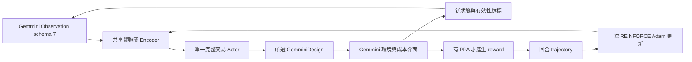

# Gemmini 與 RACE RL 的 GEMM 串接

此頁保留 schema 7／GEMM foundation 的設計與驗證；新版完整 CNN、schema 8 與 GUI 的現況見 [完整 CNN 串接](cnn_hierarchy.md)。下面未涵蓋 CNN 的敘述是此 GEMM-only 入口的範圍，不是目前專案所有入口。

2026 年 10 月 14 日完成第一個可執行串接入口：同一個 `RACETrainer` 使用 Gemmini schema 7 的關聯圖 Encoder 與單一 Actor，提出完整 GEMM 設計，再由 Gemmini 環境回傳實際模型結果。此入口支援完整 GEMM 任務，沒有宣稱七個 CNN 或完整晶片 PPA 已遷移。現有 GUI 與原 CNN CLI 保留原合成環境；新入口明確隔離模型、成本資料與 checkpoint 身份。

## 目前硬體配置

每顆 chiplet 使用 [以 Gemmini 為參照的記憶體研究配置](gemmini_hardware.md)；來源 commit 為 `8c3f9923a44a2fe2c7930587be297d6d4f8c09ca`。

| 元件 | 固定配置 | 資料身份 |
| --- | --- | --- |
| 運算陣列 | 16×16、256 PE | 公開原始碼 |
| 輸入／權重 | signed INT8 | 公開原始碼 |
| 累加 | 分析模型採 INT32；官方 array 內部 20-bit 中間訊號尚未重現 | 分析式範圍與官方訊號分開 |
| GB SRAM | 256 KiB、4 banks、single-port、每 bank 16 bytes/cycle | 容量參照官方；用途與服務率為研究配置 |
| LB SRAM | 20 KiB；A/B 各兩個 4 KiB slots、output 4 KiB | 研究擴充 |
| RF | A 256 bytes、B 256 bytes、psum 1024 bytes | 研究擴充；與 accumulator 分開 |
| Accumulator SRAM | 64 KiB、2 banks、非 single-port、每列 64 bytes | 公開配置與推導 |
| DMA | 128-bit bus、最大 transaction 64 bytes | 公開原始碼 |
| Dataflow | 公開硬體支援 WS／OS；本模型執行 WS | 支援範圍明確分開 |
| Compute chiplets | 同規格 1–16 顆，由 Agent 選擇，起始 2 顆 | 本專案設計空間 |
| 晶粒間網路 | 精確因數矩形 mesh、XY route、16 bytes/cycle、2 cycles/hop | 研究擴充與情境假設 |
| 外部記憶體 | 1 GiB、單一共享通道接 c0、16 bytes/cycle、每 transaction 20 cycles | 研究情境假設 |
| 時脈／面積／能量 | 預設缺值；不從官方 defaultConfig 推定 | 尚待可追溯成本資料 |

晶粒內已改為 DRAM→GB→LB→RF→PE，LB 另連 accumulator；來源參照與新增研究配置分開記錄。GB／LB banks、RF A／B／psum、ACC banks、DMA、array 都有獨立 graph 節點；內部 buffer 不算成額外 chiplet。配置見 `configs/memory_hierarchy.json`，可用 `--memory` 指定同格式檔案。

## 一個完整 action

`GemminiDesign` 一次指定：

- `compute_count`：1–16 顆。
- `m_tile / n_tile / k_tile`：完整 blocking triple。
- `retain_weights`：當前 N-block 的權重是否在 GB 駐留。
- `double_buffer`：是否使用不同 banks 的 ping-pong slots。
- `target / spread`：全部輸出 blocks 放在單顆，或自指定 chiplet 起 round-robin。

目前 blocking profiles 是 `(16,16,16)`、`(32,16,32)`、`(16,32,32)`、`(32,32,64)`、`(64,64,64)`。位置規則是有限的 single／round-robin 家族，不是任意 mapping 的完整枚舉；K blocking 是晶粒內 reduction，尚無跨晶粒 K reduction。硬體能力、探索範圍與 RL 方法的效果需要分開驗證。

Actor 只計算所宣告完整交易的機率，5% 均勻探索混入實際分布；沒有 Critic、候選 PPA 預測器或另一個 mapper。候選 catalogue 不呼叫硬體模型；面積／功耗上限不會在 action 前排除 chiplet 顆數。動作中的 DMA／microtile 指令是所選方案的執行工作，不是多次 RL action 或多次候選評估。

## State 與策略更新



Schema 7 保留 Tile 23 維、hardware 9 維、Link 4 維、Global 22 維與 Task 16 維。Tile 額外 6 維明列 M／N／K 範圍座標；Global 額外提供完整 GEMM shape、當前 blocking、駐留／雙緩衝／配置與回饋有效性。硬體 graph 特徵的吞吐量與頻寬使用 MAC/cycle、bytes/cycle；PPA 回饋仍使用 W、s、mm²，與舊 schema 5 的單位契約分開。

graph 表示 A／B→輸出 blocks→C 的相依、blocks→array 的配置，以及 array、GB／LB banks、RF、ACC banks、DMA、DRAM、mesh 的關係。模型執行後才填入 busy、各層內部 bytes 與 D2D dependency-link 歸因；內部 GB／LB／RF 路徑流量也回到 graph。這是完整狀態的壓縮表示，尚未證明 Markov sufficiency，也沒有新增未校準的 criticality 數值。

reset 只建立結構，current／best PPA 皆空，初始 reward 是無效 placeholder。完整 action 後才呼叫一次 Oracle；相同所選方案使用本回合快取，但仍計一次互動。有效但 PPA 較差／超標的設計可成為 current；best 另行保留。回合結束仍用原 `RACETrainer` 的 REINFORCE、gamma=1、一次 Adam 更新；使用 `policy_backend='gemmini'` 建立這個單一 Encoder／Actor。

## PPA 成本介面與缺值處理

公開硬體配置無法自行提供製程、時脈、面積與存取能量。`configs/gemmini_ppa_template.json` 的成本因此保留 `null`，另固定記憶體身份，不填入舊合成係數。

`GemminiCostProfile` 要求 clock、整顆 compute die area、純 MAC 算術、**GB／LB／RF／ACC 各自的 endpoint-byte 存取成本**、DRAM、DMA、D2D 及靜態功耗與來源。每個 copy 的來源讀與目的寫各計一次，RF 的 MAC 讀寫另計；MAC 係數不含 RF／記憶體，避免重複。

新增 `memory_hierarchy_identity` 必須與環境一致；GB／LB／RF 組織或容量更改後不能套用另一架構的晶粒面積。原 `scratchpad_byte_j`、`mac_and_pe_storage_j` profile 不相容，也不自動轉換。晶粒面積包含 GB／LB／RF／ACC、陣列、DMA、router／PHY，外部 DRAM 與封裝排除。

`DECLARED_ESTIMATE`、`RTL_DERIVED`、`MEASURED` 是成本檔案提供者宣告的證據身份；來源欄位必填不等於本程式已獨立驗證其量測。即使成本來自量測，本模型時序仍標示 `ANALYTICAL_UNVALIDATED`，不把整套 PPA 標為 silicon measurement。

未提供成本資料時，一個 action 仍可取得模型 cycles、流量與新狀態，回傳 `reward=None`、`ppa_valid=false`、`last_reward_valid=false`，終止為 `ppa_unavailable`。`RACETrainer` 拒絕以缺值更新策略，不把 cycles／bytes 變成代替 PPA 的 reward，也不呼叫舊 spill-all Oracle 補數字。

有完整成本 profile 時，環境在 action 後用固定 PPA 限制與五種偏好計算平均功耗、推論延遲及晶粒面積，再沿用原達標優先評分與 verified-best dense reward。沒有 EDP。這是來源明列的模型估計模式，仍需要 RTL／元件成本校準。

## 重現串接

先檢視未校準的真實回饋流程，不更新策略：

```sh
python tools/run_gemmini_rl.py --inspect --out experiments/runs/gemmini_inspect
```

只驗證 RL 更新機制的測試：

```sh
python tools/run_gemmini_rl.py --integration-smoke --out experiments/runs/gemmini_integration_smoke
```

第二個命令固定 2 回合、每回合 4 次完整互動，仍由同一 Agent 選 1–16 顆。成本明確為 `TEST_FIXTURE`，只驗證 action→PPA 介面→reward→next state→REINFORCE；不是 Gemmini 真實 PPA、正式成效或收斂證據。測試係數只在測試程式內，不列入正式配置，也不能透過一般 `--ppa-profile` 悄悄載入。

具可追溯成本資料後，才執行 PPA 訓練：

```sh
python tools/run_gemmini_rl.py --train --ppa-profile path/to/sourced_costs.json --requirements path/to/vendor_limits.json --episodes 60 --steps 64 --out experiments/runs/gemmini_training
```

macOS 使用 `.venv/bin/python`；Windows 使用 `.venv\Scripts\python.exe`。輸出集中在 protocol／report／checkpoint，跨回合保留最佳設計；非空輸出目錄拒絕覆寫。protocol 記錄硬體、成本來源、shape、探索範圍、演算法與 source hashes；新 schema 與來源身份不重用舊 checkpoint。

## 目前驗證與後續範圍

新增 11 個串接測試，核對 reset／Actor 零模型呼叫、一 action 一入口、last reward／新 PPA 回到 observation、缺值禁止更新、回合一次更新、凍結不更新、較差有效 current、快取計費、物理失敗無舊後端 fallback，以及 checkpoint 身份隔離。新增層級後完整本機 197 個測試通過。

本次 smoke 有 8 次完整互動、2 次策略更新，參數 hash 確實改變；測試身份始終保留 `TEST_FIXTURE`。檢視模式有一次模型評估、零策略更新，缺少 PPA 時沒有 reward。新版小型證據位於 [記憶體階層與串接驗證](evidence/memory_hierarchy/verification.json)。`evidence/gemmini_rl_integration` 為 schema 6／v1 的歷史結果，不可混入新模型成效。

完整 CNN 的 convolution lowering 成本、grouped／depthwise、非卷積算子、bias／requantization、跨層 activation 駐留、halo 交換與跨晶粒 reduction 尚未接入。現有七模型訓練與 GUI 不因本次串接被重標為 Gemmini 結果；這些功能完成並校準後，才遷移其正式搜尋入口。
