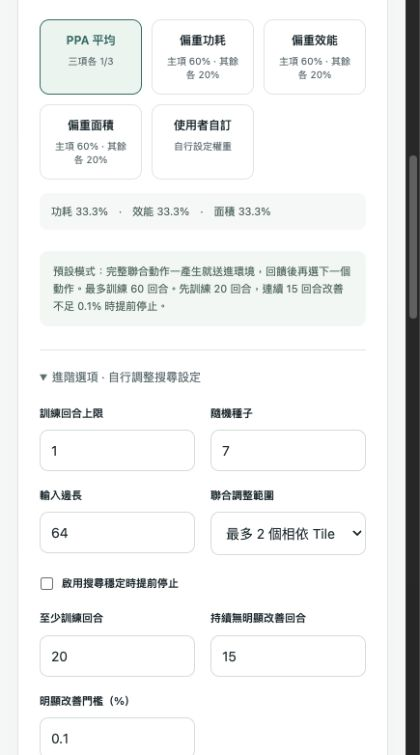
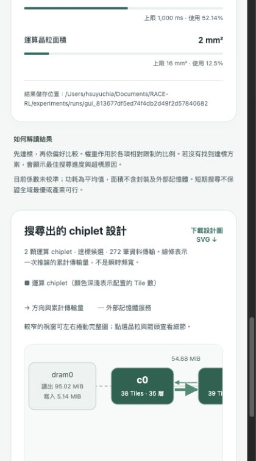

# Python 本機網頁 GUI

GUI 使用 Python 標準函式庫啟動 `127.0.0.1` 本機 HTTP server，使用瀏覽器操作。同一份介面與後端設計支援 macOS／Windows，不需要 Node.js 或另一個搜尋引擎。搜尋仍透過原有 `race_rl.cli search-mesh` 執行，數值驗證、PPA 評分、state/action 與正式 REINFORCE 不另寫一套。

## 安裝與啟動

在專案資料夾內，先安裝 Python 3.12、建立環境與研究依賴。

macOS：

```sh
python3 -m venv .venv
.venv/bin/python -m pip install -e '.[rl,cnn]'
.venv/bin/python -m race_gui.server
```

安裝後，也可雙擊 `launchers/start_macos.command`。

Windows PowerShell：

```powershell
py -3.12 -m venv .venv
.venv\Scripts\python -m pip install -e ".[rl,cnn]"
.venv\Scripts\python -m race_gui.server
```

安裝後，也可雙擊 `launchers/start_windows.bat`。啟動器會使用專案的 Python 環境，不會自動安裝或下載依賴。需在含 `third_party/` 與原生來源 lock 的完整 Git checkout 執行。

預設網址 `http://127.0.0.1:8765`，啟動時自動開啟瀏覽器。若連接埠占用可加 `--port 8766`；只啟動 server 可加 `--no-browser`。用 Ctrl+C 關閉 server，也會停止當前搜尋。

## 正式動作流程

正式策略為 REINFORCE，沒有 PPO 或 Critic。預設可選最多 2 個相依 Tile，聯合修改中間不計算 PPA；完整動作一生成就送給環境評估，回饋後才產生下一個。原本每回合評估／動作次數欄位已移除。單項修改與 PPO 分別為比較設定及比較模型。

## 操作流程

1. 選擇 DNN，輸入平均功耗 W、單次推論延遲 ms、運算晶粒面積 mm² 三項上限。
2. 五選一：PPA 平均、偏重功耗、偏重效能、偏重面積、使用者自訂。自訂顯示三個權重輸入及正規化百分比。
3. 一般使用者直接使用預設設定；熟悉研究的使用者可展開進階選項，調整回合上限、seed、輸入尺寸、scope 與提前停止條件。GUI 不提供顆數或候選集合控制；同一個 RL 固定可選 1–16 任一顆數，起始 2 顆由系統定義。
4. 開始探索。先做 DNN 數值驗證，通過後啟動 RL。進度表示實際完成的訓練回合，不是預估剩餘時間。
5. 查看 PPA、限制使用比例、顆數、加權成本、是否達標；下載 JSON 報告及 SVG 設計圖。詳細設計、查詢紀錄、checkpoint 與候選結果保存在畫面顯示的本機資料夾。

三項上限沒有預填範例成為使用者需求。偏重選項為 60/20/20，平均各 1/3；自訂須非負且總和大於零。GUI 將 ms 精確轉換成 s，再交給與 CLI 相同的 `PPARequirements`。顆數固定於後端，API 不接受使用者覆寫候選集合。輸入先驗證才建立搜尋，限制缺項或錯誤不啟動模型。

每次搜尋使用獨立子程序與全新輸出資料夾。一次只允許一個正在執行的 job，可停止後再開始。重新整理網頁可恢復同一 server session 的 job；server 重啟後不會自動恢復已中斷的訓練。

停止或失敗時不會偽造完成結果。只有完整成功結束且三項皆達標，才顯示達標候選；`NO_FEASIBLE_DESIGN_FOUND` 會顯示未達標與最佳搜尋進度，違規原因逐项列出。

## 預設搜尋設定與停止原因

一般模式固定使用最多 60 回合、每回合最多 64 次完整 action→環境回饋，scope=2、seed=7、224×224 輸入；最大訓練評估預算為 3,840 次，起始不計算 PPA，重複設計仍算一次互動。這是提高探索量的起始建議，不是已完成多模型 validation 的最佳設定，也不能保證指定回合數會收斂。

預設提前停止：至少 20 回合後，連續 15 回合未達 0.1% 的顯著改善，就以 `OBJECTIVE_PLATEAU` 結束。達標前監看 feasibility-first merit，達標後監看廠商加權成本；首次達標一定重設等待計數。小幅改善累計相對於上一次顯著改善的 reference 判斷，不是逐回合差距。

這是已觀察到的搜尋目標趨於穩定，不是神經 policy 已收斂或全域最優的證明。未達標時仍可 plateau 停止，結果必须標示未達標。若用完回合上限則為 `EPISODE_LIMIT`。進階使用者可修改或停用提前停止；訓練成本與實際完成回合會留在報告中。

研究配對 pilot 為公平比較而停用提前停止，所有組使用固定相同預算。一般 GUI 模式與正式演算法比較的停止契約不同，不能混在同一平均成績裡。

## 設計圖

設計圖直接讀取最後選中的 hardware、mapping、evaluation，不用猜測或製造流量。實體 compute nodes 依 mesh x/y 關係排列；矩形大小是示意，不是封裝尺寸比例。顯示各顆配置的 Tile／operator 數，點選晶粒可查看工作與實際座標，另有逐層配置表。

實體鏈路依 route ledger 彙總兩個方向的累計 bytes，用箭頭、粗細及數值呈現；點選鏈路可查看各方向資料量。灰線表示該選中設計的推論沒有使用鏈路，不代表不存在。線條粗細是傳輸量，不是利用率、峰值頻寬或逐時動畫。Hop bytes 會對每一跳累計，不能當作不重複的資料大小。

`dram0`／`dram1` 畫在 mesh 外側，標示讀出／寫入量與邏輯 gateway；它們沒有實體座標、面積或轉送角色。主要資料傳輸表保留 tensor、來源、目的與實際 route。圖也可畫未達標的 closest 設計，但標題會明示未達標。下載 JSON 包含相同的彙整資料，SVG 可完整檢視與引用。

## 實作與驗證界線

後端 `src/race_gui/server.py`、介面 `src/race_gui/static/`。後端以參數列表建立子程序，不拼接 shell 命令；只綁本機 loopback，驗證本機 Host／Origin 與 session token。静態頁面及字型不依賴 CDN，DNN 使用 seeded random weights，不下載 pretrained model。

自動測試涵蓋同一 PPA 契約、ms 換算、輸入拒絕、參數传遞、本機 HTTP、執行失敗、同時搜尋拒絕與取消。另以真實 CLI 搜尋核對 GUI 的輸入／輸出。

本機驗證平台為 macOS。GitHub Actions 已加入 Ubuntu／macOS／Windows matrix，但尚未執行雲端 CI，也沒有在 Windows 實機驗收；因此目前是跨平台實作，不能寫成 Windows 已實測通過。物理係數未校準，GUI 不把分析式結果稱為矽片量測。

## 本次網頁驗證

實際 ResNet-18 64×64 測試已完成，頁面顯示原始 PPA、2 顆 compute chiplet、Tile 配置及 272 筆傳輸。完整流程約 55 秒，Agent 動作生成平均約 0.08 秒。測試僅 1 回合，不是收斂驗證，也不是 224×224 執行時間估計。





完整匯出圖：[搜尋出的設計 SVG](figures/searched_chiplet_design.svg)。
