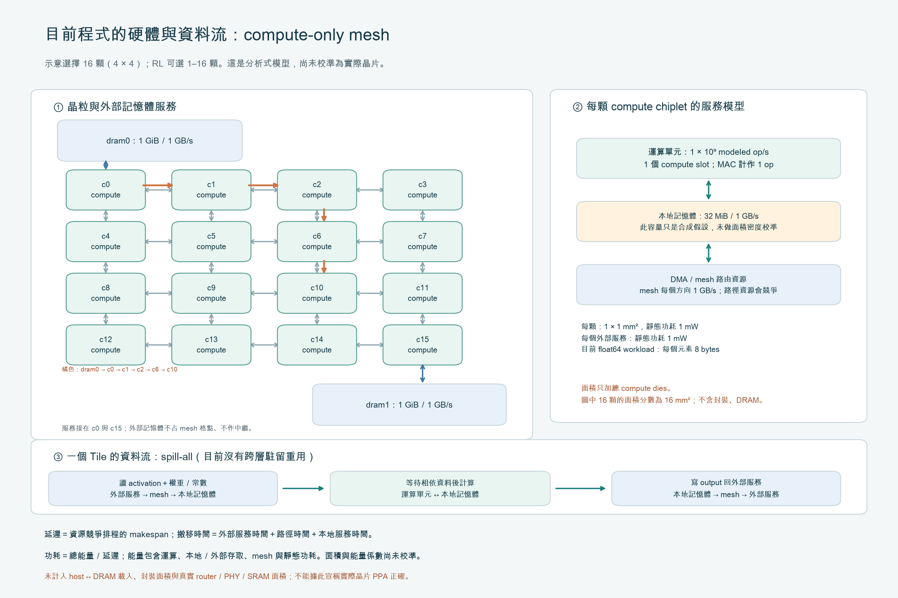

# 舊 CNN／GUI 合成硬體與資料流

本頁描述仍由 GUI／原 CNN 搜尋使用的合成服務模型。[Gemmini 單晶粒模型](gemmini_hardware.md)已建立公開配置參照與 DRAM→GB→LB→RF→PE 的研究擴充，並[接入同一 REINFORCE trainer 的 GEMM 後端](gemmini_rl_integration.md)。缺少成本資料時禁止 PPA reward 與策略更新；GUI 預設與七模型主入口已改為 [完整 CNN 新階層](cnn_hierarchy.md)；本頁僅供顯式選取的舊合成比較。

這張圖對應目前程式的分析式服務模型，並非已驗證的實體微架構。示例為 16 顆的 4×4 mesh；RL 可以選 1–16 顆，外部記憶體服務固定接在 c0 與 cN−1。每顆假定運算速率 1 G modeled op/s、本地記憶體 32 MiB／1 GB/s、晶粒面積 1 mm²、靜態功耗 1 mW。兩個外部服務各 1 GiB／1 GB/s／1 mW，沒有實體記憶晶粒與中繼功能。網路每方向 1 GB/s。

輸入和權重／常數假定已在外部記憶體。每個 Tile 經由其 storage 指定的服務、mesh 路徑與 DMA 讀入本地記憶體，取得相依資料後運算，再將輸出寫回指定外部服務。下一層再讀取；目前是 spill-all，沒有跨層 activation 駐留、權重常駐或完整 dataflow 選擇。橘色路徑是說明資料入口的示例，不是 RL 已選出的最佳 mapping。

每次搬移的時間是外部服務時間＋網路時間＋本地服務時間，並在排程中占用外部埠、DMA、本地記憶體與經過的有向 link。compute 時間是 modeled operations／運算速率＋本地存取 bytes／頻寬。相同晶粒的 Tile 採 serial_node_tiles；排程 makespan 作為推論延遲。平均功耗＝包含動態與靜態項的總能量／延遲，面積只加總 compute dies。

核對入口：[mesh](../../src/race_rl/mesh.py)、[資源／流量／排程](../../src/race_rl/oracle.py)、[硬體與路由](../../src/race_rl/hardware.py)。現行 MAC 算作一個 modeled operation；float64 workload 的每元素為 8 bytes。數值驗證使用 double 與真實加速器運算格式應分開定義，不能因為前者需要高精度就推定硬體也使用 float64。

目前未量測或校準 router／PHY／SRAM 面積、時序及能量；未計 host↔DRAM 載入、封裝與外部 DRAM 面積。容量與固定面積之間也尚無密度依據。因此，帳本一致不等於實際 PPA 正確。

## 擴充探索空間前需決定的事項

- 定義目標晶粒微架構、運算格式及 SRAM／NoC／DRAM 的服務與重用模型，再以可核對的測試案例驗證流量、資源衝突與 PPA。
- 現在 4D 輸出的 retile 只切 H，2D 切 feature；W、C、batch、reduction、完整 dataflow 都還沒有納入，不能稱為完整 CNN DSE。
- 224×224 需要分開量測 action 支援產生、環境評估與 policy 更新；不能用 64×64 的總時間直接線性外推。
- 先量測原生後端建立、action 枚舉及 policy distribution 重算，再考慮結構快取、向量化與在凍結軌跡上分批計算 loss；任何加速都必須證明不改 action 機率、環境資源競爭或梯度。不能直接以平行環境改變單一序列的 state/reward。
- 額外比較／中途測試另行選用，不默默把完整訓練的預算增加四倍。多個 evaluation seeds 也不能替代多個獨立 training seeds。
