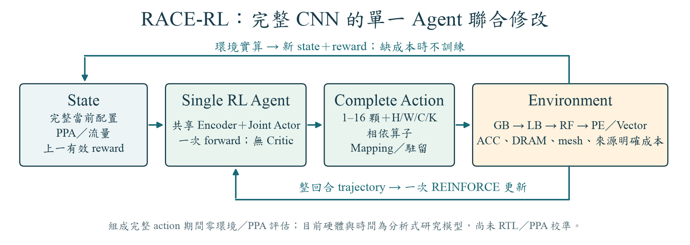
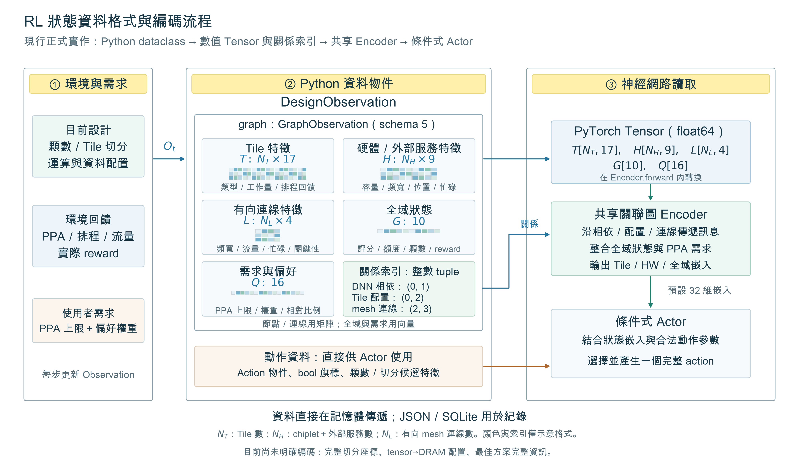

# 現行完整 CNN RL 架構

最新主入口使用 schema 8 與一次 forward 產生的完整 coupled transaction，見 [CNN RL 流程與動作](cnn_hierarchy.md)。同一 REINFORCE trainer；沒有 PPO、Critic 或 action 產生中的環境評估。正式預設最多 2 個相依實作算子可有不同 edits，硬體評估需要完整成本來源。

以下保留原合成後端的歷史定義，只有顯式比較時適用。

---

# 正式 RL 架構定義

正式版本為一個圖 Encoder、一個條件式 Actor、一個 REINFORCE optimizer。沒有 Critic、PPO、額外的顆數 optimizer 或候選 PPA 預測器。PPO 為[比較模型](comparison_models.md)，不由 GUI 呼叫。

[SVG 向量圖](figures/rl_architecture.svg)。精簡圖分為狀態、單一 Encoder／Actor、環境三區；完整 action 直接標在 Agent 至環境的箭頭上。上方為環境 reward 回路，下方為新狀態回路。三種 action 是依類別擇一提出，參數完整後立即送環境；回合結束才做一次 REINFORCE 策略更新。神經網路與 mesh 圖示只表示元件關係，不代表精確層數或實驗顆數。

中文使用標楷體（DFKai-SB），英文與數學變數使用 Times New Roman；SVG 將字形轉成向量路徑，方便跨平台分享而不依賴接收者安裝字型。

## State 與 observation

[資料格式 SVG 向量圖](figures/observation_format.svg)。環境直接傳遞記憶體中的 `DesignObservation`，內含 `GraphObservation`、動作物件、布林合法性旗標與候選特徵。Encoder 將數值 tuple 轉成正式訓練的 float64 Tensor，並按整數索引進行關係訊息傳遞；JSON／SQLite 是紀錄格式。圖中的色塊與索引只示意格式，不代表實驗數值。

完整 state 包括 workload、顆數、Tile／partition、placement／storage、需求與偏好、已測 current／best PPA、快取、requests 與剩餘額度。reset 只有結構與需求，不評估 PPA；未測 best 為空。

神經 observation schema 5 的 Tile 17 維、HW/service 9 維、Link 4 維、Global 10 維、Task 16 維。關係包含 DNN dependency、mesh、placement、dependency-link 歸因與 memory-port。尚未測得的排程／criticality／busy／traffic／PPA 以 placeholder 與有效性 mask 區分。Global 的末兩項為有無有效 current PPA、前一動作 reward。起始不需要完整排程。

這是完整 state 的壓縮表示，尚未證明 Markov sufficiency；快取 hash 與 best hash 是 metadata，不全部輸入網路。正式聯合範圍預設最多 2 個相依 Tile，1 個作比較設定，進階可調 2–4。合法 scope 是固定結構規則生成，尚不是 learned graph expansion。

目前沒有明確編碼完整切分區域座標或每個 tensor 的當前外部記憶體服務歸屬；最佳方案主要以評分與達標旗標輸入，沒有完整的最佳 PPA／mapping 表示。`feature_valid_masks` 在資料物件中保留，Encoder 不逐欄套用全部 mask；神經輸入包含未量測旗標，未測回饋以 placeholder 表示。因此不能把「完整環境 state 有保存」等同「神經網路已完整讀到」。

## Action

一個 Actor 可交错採取 resize、whole-operator retile 或 coupled mapping；conditional heads 決定完整參數，一次只抽樣一個 action。GUI 固定 1–16 顆 compute-only mesh，起始 2 顆；研究工具可宣告顆數子集合。Resize 僅用 ID modulo 重定位刪除節點的工作，之後由同一 Agent 繼續修正。

合法候選只檢查 shape、coverage、placement 與結構合法性，沒有預測候選 PPA，也不因顆數面積超標先移除候選。PPA 限制由 action 後的完整環境判定。Design family／conditional probabilities 混入 5% uniform exploration，mask 為零機率；log probability 使用實際 mixture。

## 環境與回饋

`Agent(O_t) → a_t → environment.step(a_t) → (r_t,O_(t+1),done) → 同一 Agent`。

環境先執行所選完整設計，再由按需建立的 RapidChiplet 與分析式資源計帳模型得到平均功耗、單次推論延遲與運算晶粒面積。重複 H+M 的結果由環境快取提供。所有 PPA 都有 action 對應；reset 與 Actor 不建立原生後端、不呼叫 Oracle。

物理有效 current 可接受暫時超標或較差的設計，best 另行保留；物理失敗不覆蓋有效 current。J=M/(1+M)，未測最佳 sentinel 為 1。Dense reward 為 log(舊 best J/新 best J)。詳細公式與初始／失敗行為見[訓練流程](training_process.md)。

## 策略更新

REINFORCE 使用實際 reward-to-go G_t，loss=-Σ G_t logπ_t；一回合一次 Adam 更新。無 Critic、value prediction、PPO clip、probability ratio 或 PPO epochs。state 每一步更新，策略參數在回合结束更新。float64、gamma=1、lr=3e-4、gradient norm clip=0.5。

## 程式對應

| 元件 | 程式 |
| --- | --- |
| 聯合 action／environment／完整 PPA 搜尋 | `src/race_rl/architecture.py` |
| 無 Critic Actor／關聯圖 encoder | `src/race_rl/policy.py` |
| schema 5、未知特徵 mask、last reward | `src/race_rl/observation.py` |
| 正式 REINFORCE trajectory／更新／checkpoint | `src/race_rl/training.py` |
| 達標優先與固定尺度評分 | `src/race_rl/requirements.py` |
| PPO 比較模型 | `src/race_rl/comparisons/ppo.py` |

目前係數未校準，不能宣稱 silicon PPA、跨工作負載泛化、完整收斂或全域最優。
